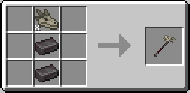
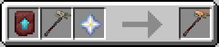
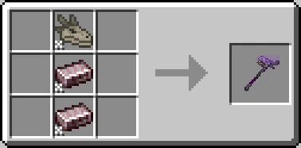
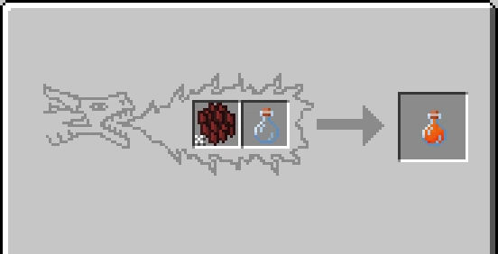
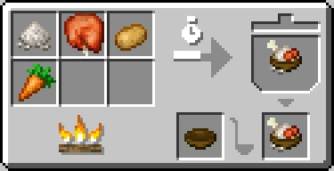
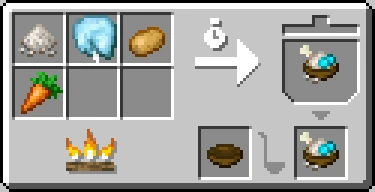
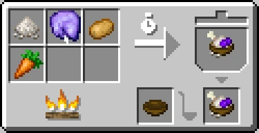
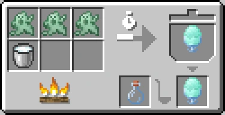
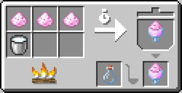

# New Content

## Netherite Dragon Armor

Netherite Dragon Armor is made in a Smithing Table using Diamond Dragon Armor, a netherite block and an upgrade smithing template.

* Head

* Neck

* Body

* Tail

## Dragon Seekers

Port of the [Ice and Fire: Dragonseeker](https://www.curseforge.com/minecraft/mc-mods/ice-and-fire-dragonseeker) addon, made for the original Ice and Fire is made a part of CE

Dragon Seekers are used to locate dragons near you. There are 4 tiers, one of which is creative mode only.

* Tier 1- Normal
  

Locates the nearest dragon in a 150 block radius.

* Tier 2- Epic
  

Locates the nearest alive dragon in a 200 block radius.

* Tier 3- Legendary
  

*Supports all the dragonsteel types
Locates the nearest wild(not tamed), alive dragon in a 300 block radius.

* Tier 4- Godly
  

Uncraftable(creative only), locates the nearest wild(not tamed), alive dragon in a 500 block radius.

## An alternative way to get Dragon Scales

You can use the new vanilla brush to get dragon scales from dragons, like you do with armadillos.

## An alternative way to get Dragon Blood

You can craft dragon blood in a Dragon Forge by putting in dragon scales and a bottle.

*Use the corresponding scale type, color doesn't matter.

## Integration: Farmer's Delight

CE adds some integration by itself. Right now, there are no addons to expand it.

* Fried Rice with Dragon Flesh

* Ghost Cream

* Pixie Dust Milky Tea

## Integration: Better Combat

Right now, most of the weapons have compatibility(swords and axes), but for others, you should use the [Ice and Fire Dragons X Better Combat](https://www.curseforge.com/minecraft/mc-mods/ice-and-fire-dragons-x-better-combat) addon. 

## Ice and Fire: Smithing

Ice and Fire: Smithing is an addon that changes crafts, to make them harder and more balanced.

Ice and Fire: Smithing modifies the crafting recipes listed in its own documentation.

