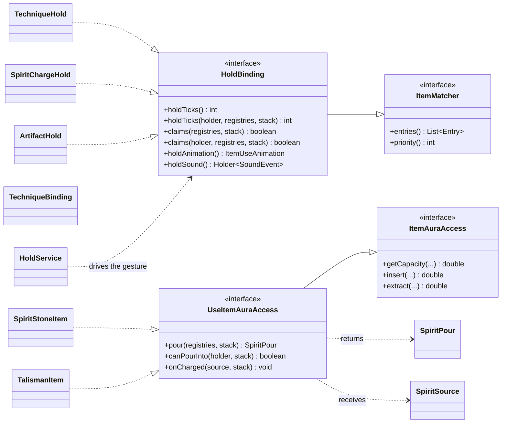

# UseItemAuraAccess

This interface extends [ItemAuraAccess](./item-aura-access.md) to support charging an item by holding right-click. `HoldBinding` / `HoldService` handle the gesture and pose; `SpiritChargeService` deducts aura from the holder each tick and writes it through `insert`. Implementations may provide a custom `pour` result or leave it empty to use the `item_aura` definition, as spirit stones do. Implementing storage alone does not enable the charging gesture.

The storage interface supports general transfers; this interface adds held-item charging. Its three default methods correspond to the following stages:

- **`pour(Provider registries, ItemStack stack)`**: queried before charging begins and each tick afterwards. Returns a `SpiritPour` listing stored amounts and capacities by aura, in charging order. Values apply to the whole stack and are not multiplied by stack size. An empty result falls back to `item_aura`; override it when capacity depends on stack state. The client also uses this result to calculate gesture duration, so implementations must use the supplied `Provider` and return consistent results for the same stack. Rates and costs belong to the gesture: definition-driven charging reverses the two rates, while self-described storage uses 1 unit/tick at 1:1.
- **`canPourInto(@Nullable LivingEntity holder, ItemStack stack)`**: checks eligibility each tick before payment and defaults to `true`. The actual order is aura deduction, `insert`, then `onCharged`; return `false` here when charging would be ineffective. Talismans use `TalismanService.canFireFrom` to check holder cooldown. Automatic activation is controlled separately by `mxt:talisman.mode`: `fire` activates on a full charge, while `store` only stores aura.
- **`onCharged(SpiritSource source, ItemStack stack)`**: called after an actual aura transfer so the item can check whether it is full and perform any resulting action. The default does nothing.

The writer must call `onCharged(SpiritSource, ItemStack)` after an actual transfer, but not during simulation. Held charging and `AuraAccess` block entities follow this contract; storage-only items require no notification. `SpiritSource(level, position, actor, consumedByHand)` supplies the actor and position: the actor pays costs and provides the effect subject, while the position supplies the activation origin and formula variables `block_x` / `block_y` / `block_z`. `consumedByHand` identifies hand use and is `false` for storage in display stands or machines. A talisman may activate in this callback and consume its carrier or durability.

`HoldBinding` provides entity-aware default overloads, `claims(LivingEntity, Provider, ItemStack)` and `holdTicks(LivingEntity, Provider, ItemStack)`. Override them when eligibility or duration depends on the holder. [Artifacts](../../../datapack/json/artifact.md) use them to avoid intercepting use by a non-owner.

Pouring supports fractions: a self-described store accepts up to `1.0` per tick, and a final `0.25` gap accepts and charges only `0.25`. Definition-driven pouring follows `consume_speed × stack size` without a one-unit minimum. `SpiritPour.Entry` uses `double` for `stored` and `capacity`, as does the pour `intake`; only percentages and gesture ticks are rounded. Displayed values use two decimal places.

Implementations can opt into general storage, charging notifications and held interaction independently, without implementing unused interaction layers.

