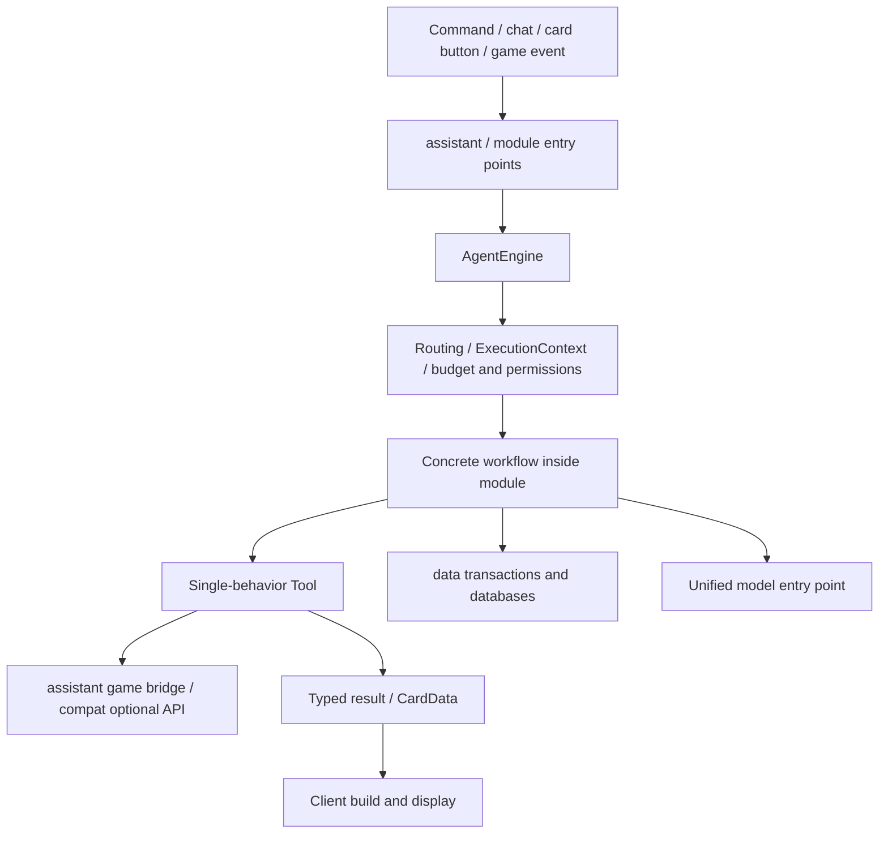

This reorganization splits the code into packages by responsibility and also moves ownership of the shop, binding, database, search and quest narration out of AgentEngine. They are created by AssistantServer in the service instance of each world save and are provided explicitly, through ModuleContext, to the modules that need them.

## Where code lives

| Package | Contents | Not responsible for |
| --- | --- | --- |
| `agent` | The root package keeps only common results, exceptions, Failure implementations and lifecycle; `execution` holds execution and budgets; `module` the workflow contract; `tool` tool capabilities; `command` commands; `react` the loop; `storage` the storage contract and history projection; `routing` routing; `model` models; `request`/`response` the protocol | Binding text, shop catalog, quotes, charging, concrete quests and game API |
| `assistant` | MC service assembly, player connection and binding, request dispatch, main thread bridging; game Tool, trading and catalog permissions | Intent routing algorithms, data file formats, card rendering |
| `data` | Business parameters and results, Codec, player file transactions and execution ledger implementations, shared/player databases, registry data and prompt loading | Workflow selection, game thread operations |
| `module` | Feature contracts and ModuleManager; configuration types, entry points, workflows and tool composition under builtin | Generic execution budgets, network protocol handling |
| `speech` | ASR, TTS, playback sessions and quest narration organization; background classification and caches under quest | Shop and quest progress writes |

Network, registry, configuration, UI, compatibility layers and general utilities keep their existing responsibilities. This split concerns code responsibility only; the shared Codec, Identifier and text component types are still MC/DFU types, and no independent Minecraft-free artifact has been introduced.

Specific locations:

- `module.builtin.<feature>`: Agent workflows; local knowledge lookup and web search tools also live next to the corresponding feature.
- `assistant.tool.<feature>`: single-behavior Handlers that depend on MC business logic; the FTB native API stays isolated in `compat.ftb`.
- `module.builtin.BuiltinTools`: shared tool type keys, input MapCodec and output Codec; it does not execute tools.
- `data.input` / `data.output` / `data.result` / `data.search`: request parameters, query results, business card results and search planning data.
- `data.store`: PlayerData, FileAgentStore, business receipts and AgentJournalDataStorage; feature-specific storage remains under `module.builtin.storage`.
- `data.database` / `data.prompt`: databases and knowledge index; prompt snapshots, placeholders and the txt reload listener.
- `speech.quest`: QuestNarration and QuestBackgrounds, metered through the unified model entry point.

## Assembly and execution

AssistantServer creates the database, AgentEngine, SearchGateway, QuestNarration and ModuleManager. The engine constructor parameters are only AgentStore, ModelClient and a function that resolves AgentJournal within a transaction; the host maps that function to the core module's ledger storage. The engine and execution context therefore no longer call ModuleData or CoreSystemModule directly.

AssistantServer uses a single volatile INSTANCE: it is published on ServerStartedEvent after all services have been built, and ServerStoppingEvent clears the reference first, then shuts down player sessions and resources; a failed startup also cleans up the resources already created. `get(server)` still checks whether the server object matches, so a late callback from the previous world save cannot access the new instance. There is no global Map keyed by MinecraftServer, and no fields are injected into MinecraftServer and no corresponding Mixin is added.

AgentEngine and the module registry on ModuleContext are fixed fields required by the constructor and are read directly through engine() / modules(). Other services are injected by AssistantServer as a `Map<ContextType<?>, Object>`, and modules obtain the corresponding type directly with get; the built-in keys live in ContextTypes, and extensions can declare their own ContextType without adding context fields or constructor parameters. ModuleManager publishes ModuleContextEvent before assembling any tool or workflow, so other mods can add services synchronously. All configurations share the same service Map, while each configuration instance still has its own owner ID and tool instance cache; ContextType matches by object identity, and the name is used only for diagnostics. Whatever service is needed is passed into the constructor of the corresponding workflow or Tool; server instances are not stored in static module definitions, and the execution engine does not become a lookup service for business services.

A Tool performs exactly one behavior; a Module composes several tools with a List. ModuleRegistry and ToolRegistry still own tool identity, owner, availability and allowlists, and ExecutionContext uniformly handles execution budgets, write receipts and cancellation checks. New features do not need business fields or feature-ID branches added to AgentEngine.

The trade receipt is built once inside the transaction with the lottery pool source needed for display, and the workflow returns it directly through AgentResult.data; it no longer borrows a preview request object, reads the player data a second time or rebuilds the same receipt. Semantic routing reuses LexicalIndex's Match / Ranking directly, only filtering and sorting the available candidates instead of copying them into another DTO with the same fields.

Adapters with distinct responsibilities are kept: the single-behavior Tool fixes the tool identity and execution marker, ModelGateway / SearchGateway handle attribution and metering, the playerStore view validates the player and the runtime generation inside the transaction, and CommerceCatalogs generates the available catalog from module permissions. ModuleContext shares service references and reuses tool instances for each configuration instance; when a lifecycle must be shared across configurations, call sharedRuntime(type, factory) during installation, and ModuleManager maintains and closes it deduplicated per instance instead of caching runtimes in static module definitions.

Q&A still searches the current player's and the shared knowledge plus the authorized FTB guides first; external tools are authorized only when nothing is found, the network is allowed for this request and the search module is enabled. The authorization set belongs to a single ExecutionContext, is reset when a workflow is selected, and is checked again on every search/fetch. The Agent only provides the generic external tool authorization interface; the database-first and search rules are implemented by QuestionModule / WebResearch.

## Threads and lifecycle

Game APIs are still invoked on the server thread through MinecraftTools / GameTaskQueue; file I/O, model and network waits run on bounded background queues. QuestNarration uses its own work queue and creates a context through engine.background that carries the player runtime generation, conversation generation and budget checks, so the first card does not wait for model summarization.

AssistantBindings handles binding transactions and cleans up business files. Revoke/reset calls engine.invalidatePlayer, which first switches the runtime generation, cancels interactions, disables event rules and clears routing, then notifies AgentLifecycle.revoked on the maintenance thread, and only then deletes data. The trade service clears its own quotes, the database deletes the player's standalone database, the narration service cancels its own in-flight tasks, and FTB clears claim references; shared knowledge and the standalone usage ledger are kept.

AgentLifecycle.disconnected and accessChanged run on the caller thread and are used only for fast cancellation and cache invalidation; cleanup that touches the disk happens in the revoked maintenance phase. Business callbacks still use context.store or the engine.playerStore captured at submission time, and callbacks from an old generation cannot rebuild data that has already been deleted.

When the service shuts down, resources are released in reverse creation order: module sessions and workers, quest narration, search, the Agent executor/model/player files, and finally the database; if closing one resource fails, the failure is logged and the other resources are still released. A failure partway through creation is also finished off with the same resource list.

This adjustment keeps registry IDs, persisted Codec fields, network protocol 1 and the isolation of optional dependencies unchanged. It changes Java type paths and the assembly API, so other Java extensions need to update their imports and constructor calls. For the verification scope, see [Compilation and acceptance](https://github.com/IAFEnvoy/System-Mod/blob/master/docs/testing.md).
