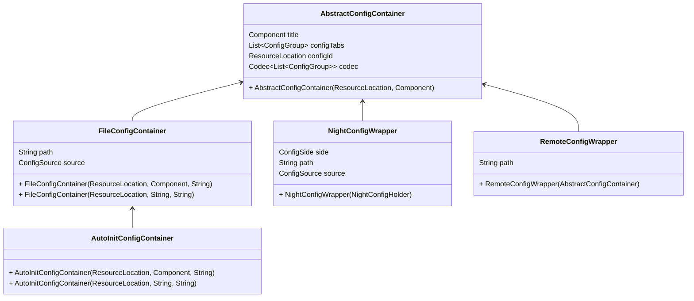

# 基本概念

## 配置容器

配置容器是所有配置的抽象实现。基类是 `AbstractConfigContainer`，所有配置容器都是它的子类。

对开发者来说，有两个容器需要用到：
- `FileConfigContainer`：表示一个需要保存到磁盘的配置。
- `AutoInitConfigContainer`：`FileConfigContainer` 的扩展版本，会通过反射自动注册配置条目。

配置容器也可以用来包装其他配置：
- `RemoteConfigWrapper`：用于在加入专用服务器时编辑服务端配置。主要区别是保存时会把值发送到服务端。
- `NightConfigWrapper`：用于支持来自 (Neo)Forge 配置系统和 `Forge Config API Port` 的 night config 数据。

## 配置条目

一个配置条目保存单个值的键值对。所有条目都是 `BaseEntry` 类的实现。（`SeparatorEntry` 除外）

由于配置条目中有很多可选字段，所有条目都通过 `Builder` 创建，你可以用 `builder()` 方法获取一个。

## 配置类型

每个配置条目都有唯一的配置类型。它用于配置值类型识别和渲染。

## 配置来源

表示配置来自何处。默认情况下你不需要关心它。
