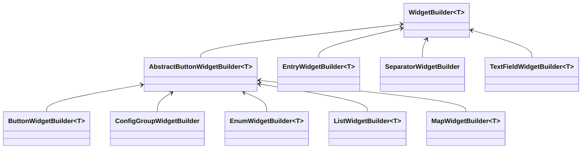

# 创建条目类型
创建新的条目类型需要 3 个部分：
- 配置类型
- 条目类
- 控件构建器

## 配置类型

你可以参考内置类型：

```java reference
https://github.com/IAFEnvoy/Jupiter/blob/main/src/main/java/com/iafenvoy/jupiter/config/type/ConfigTypes.java
```

## 条目类

要为你自己的对象类型创建条目类，请新建一个类并继承 `BaseEntry<T>`。

```java
public class BooleanEntry extends BaseEntry<Boolean> {
    protected BooleanEntry(Builder builder) {
        super(builder);
    }

    @Override
    public ConfigType<Boolean> getType() {
        return //Config type you create above.
    }

    @Override
    public IConfigEntry<Boolean> newInstance() {
        return new Builder(this).build();
    }

    @Override
    public Codec<Boolean> getCodec() {
        return Codec.BOOL;
    }
}
```

由于可选字段很多，使用构建器是创建条目的好方法。

```java
public class BooleanEntry extends BaseEntry<Boolean> {
    //BaseEntry implementation code...

    public static Builder builder(Component name, boolean defaultValue) {
        return new Builder(name, defaultValue);
    }

    public static Builder builder(String nameKey, boolean defaultValue) {
        return new Builder(nameKey, defaultValue);
    }

    public static class Builder extends BaseEntry.Builder<Boolean, BooleanEntry, Builder> {
        public Builder(Component name, boolean defaultValue) {
            super(name, defaultValue);
        }

        public Builder(String nameKey, boolean defaultValue) {
            super(nameKey, defaultValue);
        }

        public Builder(BooleanEntry parent) {
            super(parent);
        }

        @Override
        public Builder self() {
            return this;
        }

        @Override
        protected BooleanEntry buildInternal() {
            return new BooleanEntry(this);
        }
    }
}
```

## 控件构建器

它控制条目在配置界面中的显示方式。

:::warning

控件构建器仅在客户端可用。

:::

以下是一些可用的内置控件构建器：



:::warning

`TextFieldWidgetBuilder` 只能用于实现了 [`TextFieldConfigEntry`](#textfieldconfigentry) 的条目

:::

要自定义控件构建器，请创建一个继承 `WidgetBuilder<T>` 的类。

```java reference title="Example"
https://github.com/IAFEnvoy/Jupiter/blob/main/src/main/java/com/iafenvoy/jupiter/render/widget/builder/ButtonWidgetBuilder.java
```

## `TextFieldConfigEntry`

`TextFieldConfigEntry` 是用于数值的特殊接口。如果你想使用 `TextFieldWidgetBuilder`，就需要在条目中实现它。
