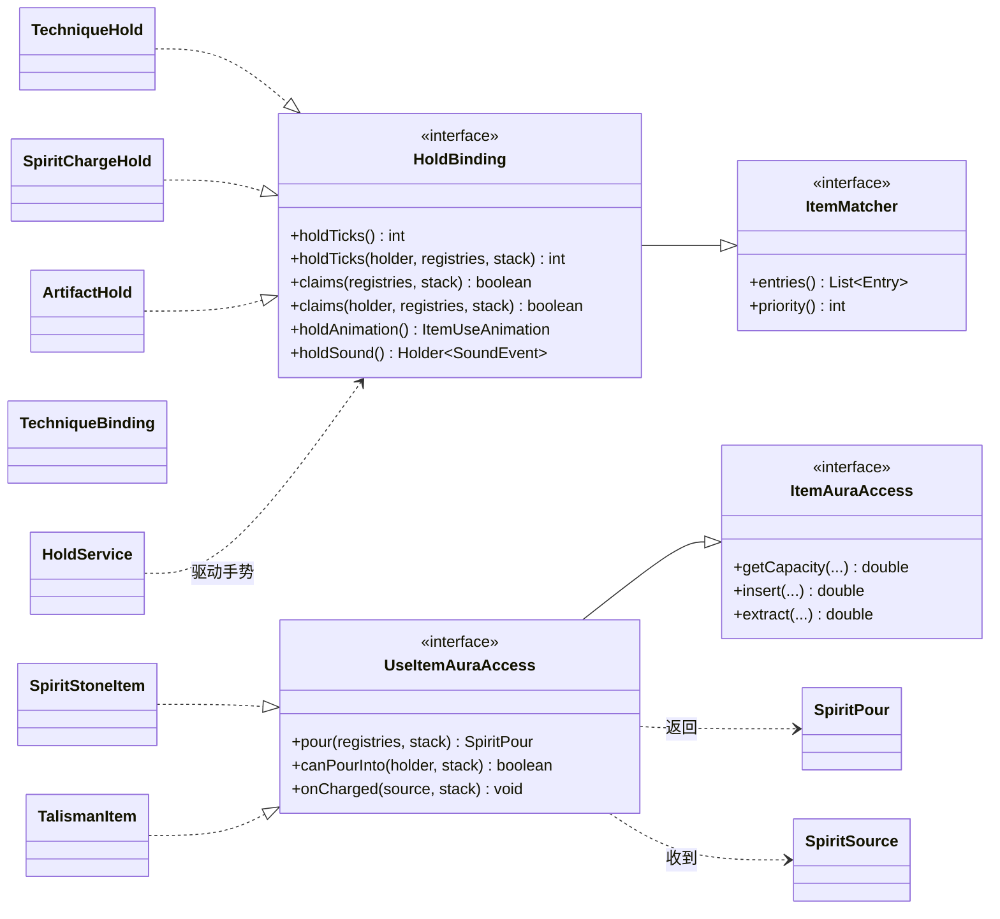

# UseItemAuraAccess

该接口继承 [ItemAuraAccess](./item-aura-access.md)，允许物品通过长按右键灌注灵气。`HoldBinding` / `HoldService` 处理手势与姿势，`SpiritChargeService` 每 tick 从持有者灵气池扣除并通过 `insert` 写入。实现可返回自定义 `pour`，或留空以使用 `item_aura` 定义；灵石采用后者。仅实现存储接口的物品不自动获得长按灌注行为。

存储接口用于通用存取，灌注接口用于持有者手中物品的长按交互。三个默认方法对应以下阶段：

- **`pour(Provider registries, ItemStack stack)`**：在手势开始前及后续每 tick 查询，返回各灵气的存量与容量组成的 `SpiritPour`，列表顺序即灌注顺序。数值按整堆给出，不再乘堆叠数量；空结果回退至 `item_aura`。容量依赖物品堆状态时可覆写。客户端也据此计算手势长度，因此只能使用传入的 `Provider`，相同物品堆应返回一致结果。此方法不定义速率与消耗：定义驱动路线反向使用两个速度，自述存储使用 1 单位/tick、1:1。
- **`canPourInto(@Nullable LivingEntity holder, ItemStack stack)`**：每 tick 在支付前校验，默认 `true`。实际顺序为扣除灵气、`insert`、`onCharged`；无法接受本次灌注时，应在此返回 `false`，避免无效消耗。符箓通过 `TalismanService.canFireFrom` 检查持有者冷却；自动发动由载体 `mxt:talisman.mode` 单独控制，`fire` 为灌满发动，`store` 为仅储存。
- **`onCharged(SpiritSource source, ItemStack stack)`**：实际转移灵气后调用，由物品判断是否已满并执行后续行为；默认不执行操作。

写入方应在真实写入后调用 `onCharged(SpiritSource, ItemStack)`，模拟操作不调用。长按灌注与 `AuraAccess` 方块实体均遵循此约定；仅实现存储的物品无需通知。`SpiritSource(level, position, actor, consumedByHand)` 提供行为者与位置：行为者承担消耗并作为效果主体，位置作为激发原点及公式变量 `block_x` / `block_y` / `block_z` 的来源；`consumedByHand` 标识是否从手中使用，展示架或机器中的存储为 `false`。符箓可在通知中发动，并消耗载体或扣除耐久。

`HoldBinding` 提供带持有者的默认重载：`claims(LivingEntity, Provider, ItemStack)` 与 `holdTicks(LivingEntity, Provider, ItemStack)`。规则不依赖持有者时无需覆写；[法器](../../../datapack/json/artifact.md)通过这些重载避免接管非主人使用物品的操作。

实现者可分别选择通用存储、灌注通知与长按交互，无需实现未使用的交互层。

灌注支持小数：自述存储每 tick 最多接收 `1.0`，仅缺 `0.25` 时接收并支付 `0.25`；定义驱动路线按 `consume_speed × 堆叠` 执行，无至少一个单位的限制。`SpiritPour.Entry.stored` / `capacity` 与灌注 `intake` 均为 `double`，仅百分比和手势 tick 数取整；数值显示保留两位小数。

